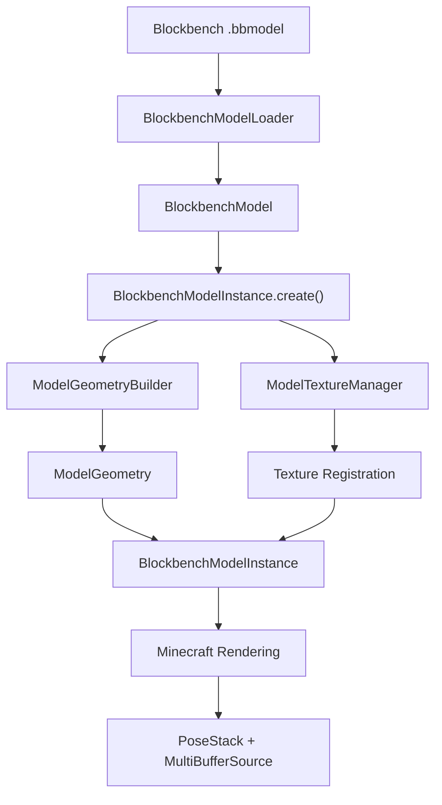

# BlockbenchModelLib
## Mod Developer Guide

**Load, manage, and render Blockbench models in Minecraft mods.**

| Requirement | Version |
|---|---|
| Minecraft | 1.21.1 |
| Mod loader | NeoForge 21.1.x |
| Java | 21 |
| Model format | Blockbench Generic Model (`.bbmodel`) |

---

# 1. Introduction

BlockbenchModelLib is a modular Java library that allows Minecraft mod developers to load and render models created with Blockbench.

The library provides a complete pipeline for converting Blockbench model files into Minecraft-renderable geometry, including texture resolution and registration.

Rather than implementing custom model parsers, geometry builders, and texture management systems, mod developers can use BlockbenchModelLib to handle these operations.

The main runtime API is `BlockbenchModelInstance`, which combines a parsed Blockbench model, generated geometry, and registered textures into a reusable rendering instance.

### Features

- Load Blockbench Generic Model (`.bbmodel`) files.
- Parse model metadata, elements, and outliner structures.
- Generate Minecraft-compatible geometry.
- Preserve cube rotations and face-specific UV mappings.
- Handle multiple textures.
- Resolve embedded and external texture resources.
- Inspect generated geometry and model bounds.
- Render models using Minecraft's rendering infrastructure.
- Support resource-pack-aware model loading.

# 2. Architecture

BlockbenchModelLib consists of three main modules.

| Module | Responsibility |
|---|---|
| `core` | Model data structures, parsing, and Minecraft-independent functionality. |
| `common` | Geometry generation, texture management, and Minecraft rendering integration. |
| `neoforge` | NeoForge-specific integration. |

### Main rendering pipeline



Most mod developers only need to interact with the loader, model instance, texture manager, and bounds API.

# 3. Adding BlockbenchModelLib

BlockbenchModelLib is distributed as Gradle artifacts.

For local development, the Maven repository is generated in:

```text
BlockbenchModelLib/build/repo/
```

Add the repository to your mod project:

```gradle
repositories {
    maven {
        url = uri("path/to/BlockbenchModelLib/build/repo")
    }
}
```

Then add the appropriate library dependencies.

The exact group, artifact, and version coordinates should match the published BlockbenchModelLib release.

For NeoForge projects, use the modules required by your integration rather than depending on internal source directories.

# 4. Preparing Blockbench models

BlockbenchModelLib currently targets the Generic Model format.

### Supported model format

- Format: Generic Model
- Model identifier: `free`
- Extension: `.bbmodel`

### Model preparation

For best results:

1. Create your model in Blockbench.
2. Select the Generic Model format.
3. Create your geometry using cubes.
4. Configure the textures and UV mappings.
5. Organize elements into groups when appropriate.
6. Save the model as a `.bbmodel` file.

### Recommended resource structure

Keep your models in your mod's resource directory.

Example:

```text
src/main/resources/
└── assets/
    └── mymod/
        ├── bbmodels/
        │   ├── machine.bbmodel
        │   └── machine_part.bbmodel
        └── textures/
            └── models/
                └── machine.png
```

Models should be referenced using Minecraft resource locations.

For example:

```java
ResourceLocation.fromNamespaceAndPath(
    "mymod",
    "bbmodels/machine.bbmodel"
);
```

# 5. Loading a model

The model loader is located in:

```java
com.hod.blockbench.loader.BlockbenchModelLoader
```

The loader provides several ways to load model files, including:

- `Path`
- `File`
- `InputStream`
- `Reader`

### Loading from a resource stream

For Minecraft mods, loading through the resource manager is recommended.

```java
ResourceLocation MODEL_LOCATION =
    ResourceLocation.fromNamespaceAndPath(
        "mymod",
        "bbmodels/machine.bbmodel"
    );

Minecraft minecraft = Minecraft.getInstance();

Resource resource = minecraft
    .getResourceManager()
    .getResource(MODEL_LOCATION)
    .orElseThrow(() ->
        new IOException("Missing model: " + MODEL_LOCATION)
    );

BlockbenchModel model;

try (InputStream input = resource.open()) {
    model = BlockbenchModelLoader.load(input);
}
```

The resource manager allows Minecraft resource-pack overrides to participate in resource resolution.

**Important:** When supplying an `InputStream` or `Reader` directly, the caller is responsible for closing it. The loader does not take ownership of supplied streams.

For loading Minecraft resources, the library also provides `BlockbenchResourceLoader`.

# 6. Creating a model instance

Once a model has been loaded, create a `BlockbenchModelInstance`.

This is the recommended runtime representation for rendering.

```java
Minecraft minecraft = Minecraft.getInstance();

BlockbenchModelInstance instance =
    BlockbenchModelInstance.create(
        model,
        new ModelTextureManager(minecraft.getTextureManager()),
        minecraft.getResourceManager(),
        false
    );
```

The parameters are:

| Parameter | Description |
|---|---|
| `model` | Parsed `BlockbenchModel`. |
| `ModelTextureManager` | Manages Minecraft texture registration. |
| `ResourceManager` | Provides access to Minecraft resources. |
| `false` | Configuration flag for the instance creation operation. |

The instance handles geometry generation and texture registration.

You do not need to manually build geometry or register individual textures when using this API.

### What does the instance contain?

A `BlockbenchModelInstance` exposes:

```java
instance.model();
instance.geometry();
instance.isClosed();
```

- `model()` returns the original parsed model.
- `geometry()` returns generated `ModelGeometry`.
- `isClosed()` indicates whether the instance has been closed.

### Closing an instance

Instances own their texture registrations and must be closed when they are no longer needed.

```java
instance.close();
```

Closing an instance releases its associated texture registrations.

The `ModelTextureManager` itself remains caller-owned.

Do not close an instance while it is still being used for rendering.

# 7. Understanding model geometry and bounds

BlockbenchModelLib provides geometry information through `ModelGeometry`.

One particularly useful feature is `ModelBounds`.

Bounds describe the actual dimensions of generated model geometry.

```java
ModelBounds bounds = instance
    .geometry()
    .bounds()
    .orElseThrow(() ->
        new IllegalStateException(
            "Model contains no geometry."
        )
    );
```

### Accessing the bounds

```java
ModelVector3 min = bounds.min();
ModelVector3 max = bounds.max();
ModelVector3 center = bounds.center();
```

These values represent:

| Value | Description |
|---|---|
| `min()` | Minimum X, Y, and Z coordinates. |
| `max()` | Maximum X, Y, and Z coordinates. |
| `center()` | Center of the geometry bounds. |

You can use these values to calculate model positioning without relying on hardcoded translation offsets.

### Understanding Blockbench units

Blockbench uses 16 model units per Minecraft block.

```java
private static final float BLOCKBENCH_UNITS_PER_BLOCK = 16.0F;
```

When translating model geometry in Minecraft, convert Blockbench coordinates into Minecraft block coordinates.

For example:

```java
poseStack.translate(
    -center.x() / BLOCKBENCH_UNITS_PER_BLOCK,
    -min.y() / BLOCKBENCH_UNITS_PER_BLOCK,
    -center.z() / BLOCKBENCH_UNITS_PER_BLOCK
);
```

This centers the model horizontally and positions its lowest geometry point at the origin.

This approach is preferable to manually estimating offsets.

# 8. Rendering a model

A model instance can be rendered directly:

```java
instance.render(
    poseStack,
    bufferSource,
    packedLight,
    packedOverlay
);
```

The parameters are:

| Parameter | Description |
|---|---|
| `PoseStack` | Current transformation stack. |
| `MultiBufferSource` | Minecraft vertex buffer source. |
| `packedLight` | Packed lighting information. |
| `packedOverlay` | Packed overlay information. |

The model instance handles the geometry and texture rendering.

You should not recreate the geometry or register textures every time the render method is called.

# 9. Example: Custom item renderer

One common use case is rendering a Blockbench model as an inventory item or held item.

Minecraft provides `BlockEntityWithoutLevelRenderer` for this purpose.

The following example demonstrates a complete item renderer.

### TextileMachineItemRenderer.java

```java
package com.example.mymod.client.render;

import com.hod.blockbench.common.geometry.ModelBounds;
import com.hod.blockbench.common.render.BlockbenchModelInstance;
import com.hod.blockbench.common.render.texture.ModelTextureManager;
import com.hod.blockbench.loader.BlockbenchModelLoader;
import com.hod.blockbench.model.ModelVector3;

import com.mojang.blaze3d.vertex.PoseStack;
import com.mojang.logging.LogUtils;

import java.io.IOException;
import java.io.InputStream;

import net.minecraft.client.Minecraft;
import net.minecraft.client.renderer.BlockEntityWithoutLevelRenderer;
import net.minecraft.client.renderer.MultiBufferSource;
import net.minecraft.resources.ResourceLocation;
import net.minecraft.server.packs.resources.Resource;
import net.minecraft.world.item.ItemDisplayContext;
import net.minecraft.world.item.ItemStack;

import org.slf4j.Logger;

public final class MachineItemRenderer
    extends BlockEntityWithoutLevelRenderer {

    private static final Logger LOGGER =
        LogUtils.getLogger();

    private static final float BLOCKBENCH_UNITS_PER_BLOCK =
        16.0F;

    private static final ResourceLocation MODEL_LOCATION =
        ResourceLocation.fromNamespaceAndPath(
            "mymod",
            "bbmodels/machine.bbmodel"
        );

    private BlockbenchModelInstance modelInstance;

    private ModelBounds modelBounds;

    public MachineItemRenderer() {
        super(
            Minecraft.getInstance()
                .getBlockEntityRenderDispatcher(),
            Minecraft.getInstance()
                .getEntityModels()
        );
    }

    private BlockbenchModelInstance getModel() {
        if (modelInstance != null) {
            return modelInstance;
        }

        Minecraft minecraft = Minecraft.getInstance();

        try {
            Resource resource = minecraft
                .getResourceManager()
                .getResource(MODEL_LOCATION)
                .orElseThrow(() ->
                    new IOException(
                        "Missing model: " + MODEL_LOCATION
                    )
                );

            try (InputStream input = resource.open()) {
                var model = BlockbenchModelLoader.load(input);

                BlockbenchModelInstance instance =
                    BlockbenchModelInstance.create(
                        model,
                        new ModelTextureManager(
                            minecraft.getTextureManager()
                        ),
                        minecraft.getResourceManager(),
                        false
                    );

                ModelBounds bounds = instance
                    .geometry()
                    .bounds()
                    .orElseThrow(() ->
                        new IllegalStateException(
                            "Model contains no geometry."
                        )
                    );

                modelBounds = bounds;
                modelInstance = instance;
            }

            return modelInstance;

        } catch (IOException | RuntimeException exception) {
            LOGGER.error(
                "Failed to load machine item model",
                exception
            );

            return null;
        }
    }

    @Override
    public void renderByItem(
        ItemStack stack,
        ItemDisplayContext displayContext,
        PoseStack poseStack,
        MultiBufferSource bufferSource,
        int packedLight,
        int packedOverlay
    ) {
        BlockbenchModelInstance model = getModel();

        if (model == null || modelBounds == null) {
            return;
        }

        ModelVector3 min = modelBounds.min();
        ModelVector3 center = modelBounds.center();

        poseStack.pushPose();

        try {
            poseStack.translate(
                -center.x() / BLOCKBENCH_UNITS_PER_BLOCK,
                -min.y() / BLOCKBENCH_UNITS_PER_BLOCK,
                -center.z() / BLOCKBENCH_UNITS_PER_BLOCK
            );

            model.render(
                poseStack,
                bufferSource,
                packedLight,
                packedOverlay
            );

        } finally {
            poseStack.popPose();
        }
    }
}
```

### How it works

The renderer performs the following operations:

1. Lazily loads the Blockbench model.
2. Creates a `BlockbenchModelInstance`.
3. Creates a `ModelTextureManager`.
4. Generates the model geometry and registers its textures.
5. Retrieves the generated geometry bounds.
6. Calculates the positioning offset.
7. Renders the model using Minecraft's rendering pipeline.

### Why use model bounds?

Different models can have different dimensions and origins.

For example, one model might occupy coordinates from `-8` to `8`, while another occupies coordinates from `0` to `16`.

Using `ModelBounds` makes the positioning calculation independent of those dimensions.

The horizontal center is aligned with the origin, while the bottom of the model is aligned with the ground.

This makes the renderer reusable across different models without manually adjusting offsets for each one.

# 10. Registering the item renderer in NeoForge

For NeoForge 1.21.1, item renderers can be registered using `RegisterClientExtensionsEvent`.

Example:

```java
@SubscribeEvent
public static void registerClientExtensions(
    RegisterClientExtensionsEvent event
) {
    MachineItemRenderer renderer =
        new MachineItemRenderer();

    event.registerItem(
        new IClientItemExtensions() {

            @Override
            public BlockEntityWithoutLevelRenderer
                getCustomRenderer() {
                return renderer;
            }

        },
        ModItems.MACHINE.get()
    );
}
```

Register the event handler on the appropriate mod event bus.

The item model JSON should use the built-in entity parent:

```json
{
  "parent": "minecraft:builtin/entity"
}
```

This allows Minecraft to use the custom item renderer instead of the standard baked item model.

# 11. Example: Block entity renderer

BlockbenchModelLib can also be used for block entities.

The main difference is the rendering context and the transformations applied before rendering.

A typical block entity renderer follows this structure:

```java
public final class MachineBlockEntityRenderer
    implements BlockEntityRenderer<MachineBlockEntity> {

    private final BlockbenchModelInstance model;

    public MachineBlockEntityRenderer(
        BlockEntityRendererProvider.Context context
    ) {
        Minecraft minecraft = Minecraft.getInstance();

        // Load the model and create the instance here.
        // Keep the instance instead of recreating it
        // during every render call.
        this.model = loadModel(minecraft);
    }

    @Override
    public void render(
        MachineBlockEntity blockEntity,
        float partialTick,
        PoseStack poseStack,
        MultiBufferSource bufferSource,
        int packedLight,
        int packedOverlay
    ) {
        poseStack.pushPose();

        try {
            // Apply block-specific transformations here.

            model.render(
                poseStack,
                bufferSource,
                packedLight,
                packedOverlay
            );

        } finally {
            poseStack.popPose();
        }
    }
}
```

`loadModel()` above is an application-specific loading helper, not a BlockbenchModelLib API method.

Register the block entity renderer through NeoForge's `EntityRenderersEvent.RegisterRenderers`.

### Positioning block entity models

For block models, the transformation depends on the model's coordinate system and desired placement.

You can use `ModelBounds` to determine the model's dimensions and origin.

For example, horizontal centering can be calculated using:

```java
ModelVector3 center = model.geometry()
    .bounds()
    .orElseThrow()
    .center();
```

Then apply the appropriate translations and rotations before rendering.

# 12. Texture management

BlockbenchModelLib provides a texture management system.

Important classes include:

| Class | Purpose |
|---|---|
| `ModelTextureManager` | Manages Minecraft texture registration. |
| `ModelTextureRegistration` | Represents registered model textures. |
| `ModelTextureResolver` | Resolves model texture information. |
| `ResolvedModelTexture` | Represents resolved texture data. |
| `MinecraftModelTextureResolver` | Minecraft-specific texture resolution. |

### Creating a texture manager

```java
ModelTextureManager textureManager =
    new ModelTextureManager(
        Minecraft.getInstance().getTextureManager()
    );
```

The manager is supplied when creating a model instance.

### Multiple textures

Blockbench models can contain multiple textures.

BlockbenchModelLib maintains the relationship between model faces and their corresponding texture indices during geometry generation.

Developers should not assume that a model contains only one texture.

### Texture lifecycle

The model instance manages its own texture registrations.

When an instance is closed, its registrations are released.

The texture manager itself remains owned by the caller.

# 13. Resource loading and reloading

Models should be loaded through Minecraft's resource manager whenever possible.

This allows resource-pack overrides to be respected.

For example:

```java
ResourceLocation location =
    ResourceLocation.fromNamespaceAndPath(
        "mymod",
        "bbmodels/machine.bbmodel"
    );

BlockbenchModel model =
    BlockbenchResourceLoader.load(
        minecraft.getResourceManager(),
        location
    );
```

The resource loader handles opening and closing the resource stream.

### Resource reload considerations

A model instance contains generated geometry and registered textures.

When the resource environment changes, cached instances may need to be rebuilt.

A mod developer should:

1. Close the previous model instance.
2. Load the model again through the current resource manager.
3. Create a new instance.
4. Recalculate model bounds.
5. Replace the cached instance.

Do not continue rendering a closed instance.

# 14. Performance recommendations

For frequently rendered models, follow these guidelines:

- Load models outside the rendering loop.
- Create each model instance once per required rendering context.
- Cache generated geometry.
- Avoid repeatedly decoding embedded textures.
- Avoid unnecessary texture registrations.
- Cache model bounds.
- Close instances when they are no longer needed.
- Rebuild instances when relevant resources are reloaded.

The `BlockbenchModelInstance` is designed to avoid repeating geometry generation and texture registration for every frame.

# 15. Troubleshooting

| Problem | Possible cause |
|---|---|
| Model cannot be loaded | Incorrect resource location or invalid `.bbmodel` file. |
| Model does not render | Model instance failed to initialize or contains no geometry. |
| Model is incorrectly positioned | Incorrect transformation or missing bounds calculation. |
| Model is too large or small | Blockbench coordinate conversion is incorrect. |
| Incorrect texture | Invalid texture index or UV mapping. |
| Missing texture | Missing embedded image or unresolved external resource. |
| Model disappears after reload | Cached instance was not recreated. |
| Rendering fails after closing | Attempting to render a closed instance. |

# 16. API reference

The following classes are particularly useful when integrating BlockbenchModelLib.

### Loading

```java
com.hod.blockbench.loader.BlockbenchModelLoader
com.hod.blockbench.loader.BlockbenchResourceLoader
```

### Model data

```java
com.hod.blockbench.model.BlockbenchModel
com.hod.blockbench.model.ModelVector3
```

### Geometry

```java
com.hod.blockbench.common.geometry.ModelGeometry
com.hod.blockbench.common.geometry.ModelBounds
com.hod.blockbench.common.geometry.ModelGeometryBuilder
```

### Rendering

```java
com.hod.blockbench.common.render.BlockbenchModelInstance
com.hod.blockbench.common.render.BlockbenchModelRenderer
```

### Textures

```java
com.hod.blockbench.common.render.texture.ModelTextureManager
com.hod.blockbench.common.render.texture.ModelTextureRegistration
com.hod.blockbench.common.render.texture.ModelTextureResolver
com.hod.blockbench.common.render.texture.ResolvedModelTexture
```

# 17. Final notes

BlockbenchModelLib is intended to provide a reusable foundation for using Blockbench models in Minecraft mods.

Mod developers should generally follow this workflow:

1. Load a `.bbmodel` using `BlockbenchModelLoader` or `BlockbenchResourceLoader`.
2. Create a `BlockbenchModelInstance`.
3. Retrieve geometry bounds if positioning calculations are required.
4. Apply Minecraft transformations using `PoseStack`.
5. Render through `BlockbenchModelInstance.render()`.
6. Close and recreate instances when their resources are no longer valid.

For most integrations, developers should use `BlockbenchModelInstance` rather than implementing the individual geometry and texture systems themselves.

---

**BlockbenchModelLib**

*Bringing Blockbench models into Minecraft mods through a reusable rendering and model-loading library.*
