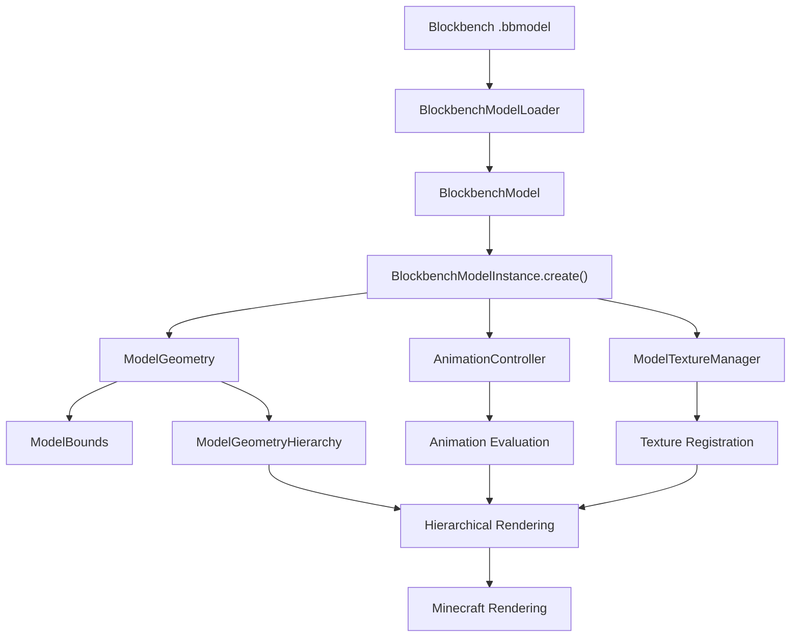
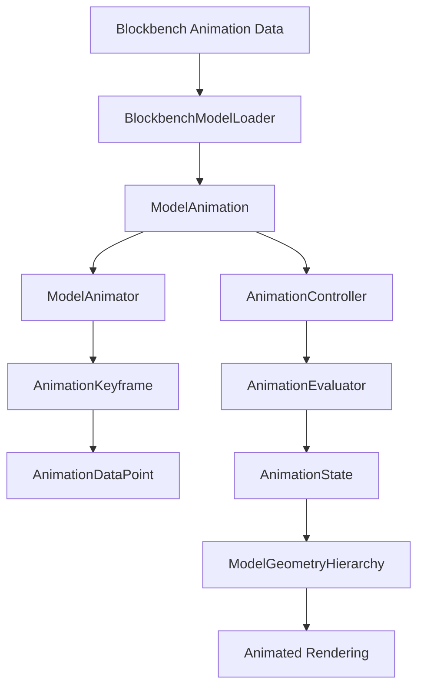

# BlockbenchModelLib – Mod Developer Guide

**Complete guide to loading, managing, animating, and rendering Blockbench models in Minecraft mods.**

| Requirement | Version |
|---|---|
| Minecraft | 1.21.1 |
| Mod loader | NeoForge 21.1.x |
| Java | 21 |
| Model format | Blockbench Generic Model (`.bbmodel`) |

> **Unofficial project:** BlockbenchModelLib is an independent project. It is not officially made by, affiliated with, endorsed by, or maintained by the Blockbench team. Blockbench and its associated trademarks belong to their respective owners.

---

# 1. Introduction

BlockbenchModelLib is a modular Java library designed to make it easier for Minecraft mod developers to use Blockbench models.

The library provides a reusable pipeline for:

- Loading and parsing Blockbench models.
- Generating Minecraft-compatible geometry.
- Managing model textures.
- Preserving model hierarchies and transformations.
- Loading and evaluating Blockbench animations.
- Controlling animation playback.
- Rendering static and animated models.

Instead of implementing these systems individually, mod developers can use BlockbenchModelLib to integrate their models into Minecraft.

## 1.1 Main capabilities

| Feature | Description |
|---|---|
| Model loading | Parse Blockbench `.bbmodel` files. |
| Geometry | Generate Minecraft-compatible geometry. |
| Textures | Resolve and register model textures. |
| UV mapping | Preserve face-specific UV coordinates and rotations. |
| Hierarchy | Preserve groups, pivots, and nested structures. |
| Bounds | Calculate model dimensions and positioning information. |
| Animation loading | Parse Blockbench animation definitions. |
| Animation evaluation | Evaluate animated transformations at specific timestamps. |
| Playback control | Play, pause, resume, stop, seek, and change playback speed. |
| Hierarchical animation | Apply animated transformations to nested model groups. |
| Rendering | Render static and animated model instances. |

# 2. Architecture

BlockbenchModelLib consists of three modules.

| Module | Responsibility |
|---|---|
| `core` | Minecraft-independent model structures, parsing, and animation evaluation. |
| `common` | Geometry generation, hierarchy, texture management, animation playback, and rendering. |
| `neoforge` | NeoForge-specific integration. |

## 2.1 Main model pipeline



## 2.2 Recommended runtime API

Most mod developers should primarily use:

```java
BlockbenchModelLoader
BlockbenchModelInstance
ModelTextureManager
ModelBounds
ModelAnimation
```

`BlockbenchModelInstance` is the main runtime integration point. It combines model geometry, texture management, hierarchy, and animation playback.

# 3. Installation

BlockbenchModelLib is built using Gradle and distributed through Maven artifacts.

For local development, the generated Maven repository is located at:

```text
BlockbenchModelLib/build/repo/
```

Add the repository to your mod project:

```gradle
repositories {
    maven {
        url = uri("path/to/BlockbenchModelLib/build/repo")
    }
}
```

Add the required library modules using their published Maven coordinates.

The exact group, artifact, and version coordinates depend on the release being used.

For NeoForge integrations, include the appropriate modules rather than depending on internal source directories.

# 4. Preparing Blockbench models

BlockbenchModelLib currently targets Blockbench Generic Model files.

## 4.1 Supported model format

- Format: Generic Model
- Model identifier: `free`
- Extension: `.bbmodel`

The current implementation supports cube-based geometry, face-specific UV coordinates, texture indices, rotations, inflation, and model hierarchy.

## 4.2 Recommended resource structure

```text
src/main/resources/
└── assets/
    └── mymod/
        ├── bbmodels/
        │   ├── machine.bbmodel
        │   └── spinning_wheel.bbmodel
        └── textures/
            └── models/
                └── machine.png
```

Reference models using Minecraft resource locations:

```java
ResourceLocation MODEL_LOCATION =
    ResourceLocation.fromNamespaceAndPath(
        "mymod",
        "bbmodels/machine.bbmodel"
    );
```

## 4.3 Preparing animations

Animations should be created in Blockbench and saved inside the Generic Model file.

The model can contain multiple named animations.

An animation contains:

- A name.
- A UUID.
- A duration.
- A loop setting.
- Animation snapping information.
- One or more animators.
- Keyframes.
- Animation channels.
- Interpolation information.
- Animation data points.

Animators target model groups using their UUIDs.

**Important:** Keep group UUIDs stable when modifying animated models. The animation system uses these identifiers to associate animators with the correct hierarchy nodes.

# 5. Loading models

The model loader is located in:

```java
com.hod.blockbench.loader.BlockbenchModelLoader
```

It supports loading from:

- `Path`
- `File`
- `InputStream`
- `Reader`

## 5.1 Loading from a Minecraft resource

For Minecraft mods, loading through the resource manager is recommended.

```java
Resource resource = minecraft
    .getResourceManager()
    .getResource(MODEL_LOCATION)
    .orElseThrow(() ->
        new IOException(
            "Missing model: " + MODEL_LOCATION
        )
    );

BlockbenchModel model;

try (InputStream input = resource.open()) {
    model = BlockbenchModelLoader.load(input);
}
```

This allows Minecraft resource-pack overrides to participate in resource resolution.

## 5.2 Resource loader

The library also provides `BlockbenchResourceLoader` for loading through Minecraft's resource manager.

```java
BlockbenchModel model =
    BlockbenchResourceLoader.load(
        minecraft.getResourceManager(),
        MODEL_LOCATION
    );
```

Use the resource loader when you want the library to handle resource stream management.

# 6. Creating a model instance

Once a model has been loaded, create a `BlockbenchModelInstance`.

```java
BlockbenchModelInstance instance =
    BlockbenchModelInstance.create(
        model,
        new ModelTextureManager(
            minecraft.getTextureManager()
        ),
        minecraft.getResourceManager(),
        false
    );
```

The parameters are:

| Parameter | Description |
|---|---|
| `model` | Parsed `BlockbenchModel`. |
| `ModelTextureManager` | Manages Minecraft texture registration. |
| `ResourceManager` | Provides access to Minecraft resources. |
| `false` | Instance creation configuration flag. |

The instance creates the generated geometry, texture registrations, and animation runtime.

## 6.1 Accessing instance data

```java
instance.model();
instance.geometry();
instance.hierarchy();
instance.animationState();
instance.isClosed();
```

These methods provide access to the parsed model, generated geometry, model hierarchy, playback state, and instance lifecycle information.

## 6.2 Closing an instance

When an instance is no longer needed:

```java
instance.close();
```

Closing the instance releases its associated texture registrations.

The texture manager itself remains caller-owned.

Never render or update a closed instance.

# 7. Geometry and model bounds

Generated geometry is represented by `ModelGeometry`.

The geometry contains information about the generated model and provides access to its bounds and hierarchy.

## 7.1 Accessing model bounds

```java
ModelBounds bounds = instance
    .geometry()
    .bounds()
    .orElseThrow(() ->
        new IllegalStateException(
            "Model contains no geometry."
        )
    );
```

Access the bounds:

```java
ModelVector3 min = bounds.min();
ModelVector3 max = bounds.max();
ModelVector3 center = bounds.center();
```

| Value | Description |
|---|---|
| `min()` | Minimum X, Y, and Z coordinates. |
| `max()` | Maximum X, Y, and Z coordinates. |
| `center()` | Center of the geometry bounds. |

## 7.2 Blockbench coordinate conversion

Blockbench uses 16 model units per Minecraft block.

```java
private static final float BLOCKBENCH_UNITS_PER_BLOCK =
    16.0F;
```

When positioning models, convert Blockbench coordinates into Minecraft coordinates.

For example, to horizontally center a model and align its bottom with the origin:

```java
ModelVector3 min = bounds.min();
ModelVector3 center = bounds.center();

poseStack.translate(
    -center.x() / BLOCKBENCH_UNITS_PER_BLOCK,
    -min.y() / BLOCKBENCH_UNITS_PER_BLOCK,
    -center.z() / BLOCKBENCH_UNITS_PER_BLOCK
);
```

This calculation works with different model dimensions and origins without manually estimating translation offsets.

# 8. Animation system

BlockbenchModelLib includes an animation system that reads animation definitions directly from Blockbench Generic Model files.

The animation system is divided into three main responsibilities:

1. Animation data and parsing.
2. Animation evaluation and playback.
3. Hierarchical rendering.

## 8.1 Animation architecture



## 8.2 Animation data structures

The animation system uses the following main classes.

| Class | Module/package | Responsibility |
|---|---|---|
| `ModelAnimation` | `com.hod.blockbench.model` | Represents an animation. |
| `ModelAnimator` | `com.hod.blockbench.model` | Represents an animated model group. |
| `AnimationKeyframe` | `com.hod.blockbench.model` | Represents an animation keyframe. |
| `AnimationDataPoint` | `com.hod.blockbench.model` | Stores keyframe transformation data. |
| `AnimationController` | `com.hod.blockbench.animation` | Controls playback. |
| `AnimationEvaluator` | `com.hod.blockbench.animation` | Evaluates animation transformations. |
| `AnimationState` | `com.hod.blockbench.animation` | Stores current playback information. |
| `AnimationPlaybackStatus` | `com.hod.blockbench.animation` | Represents playback status. |

## 8.3 Supported animation channels

The current animation evaluator supports:

| Channel | Description |
|---|---|
| `position` | Animates group position. |
| `rotation` | Animates group rotation. |
| `scale` | Animates group scale. |

Animation targets are associated with model hierarchy nodes using their UUIDs.

## 8.4 Interpolation

The current evaluator supports:

- **Linear:** Interpolates between adjacent keyframes.
- **Step:** Holds the previous keyframe value until the next keyframe.

Unsupported interpolation modes should not be assumed to behave identically to their Blockbench counterparts.

## 8.5 Loop modes

The current playback system supports:

- **Loop:** Restarts the animation after its duration.
- **Once:** Plays the animation once and stops at its end.

The loop setting is read from the Blockbench animation definition.

# 9. Animation playback

Animation playback is controlled through `BlockbenchModelInstance`.

This is the recommended API for mod developers.

## 9.1 Playing an animation by name

```java
instance.playAnimationByName("Spin");
```

This is useful when the animation name is known in advance.

## 9.2 Playing an animation by UUID

```java
instance.playAnimation(animationUuid);
```

Use this when you want to identify an animation independently of its display name.

## 9.3 Playing a ModelAnimation

```java
instance.playAnimation(animation);
```

This allows you to select an already retrieved `ModelAnimation` directly.

## 9.4 Pausing playback

```java
instance.pauseAnimation();
```

Pausing stops animation time from advancing while preserving the current playback position.

## 9.5 Resuming playback

```java
instance.resumeAnimation();
```

Resume continues from the paused position.

## 9.6 Stopping playback

```java
instance.stopAnimation();
```

Stopping resets the active playback state.

## 9.7 Changing animation speed

```java
instance.setAnimationSpeed(2.0F);
```

Examples:

| Speed | Effect |
|---|---|
| `0.5F` | Half speed. |
| `1.0F` | Normal speed. |
| `2.0F` | Double speed. |

A negative speed or other unsupported playback behavior should not be assumed to be available.

## 9.8 Seeking

The animation controller supports seeking to a specified playback position.

The controller API is available through:

```java
AnimationController
```

Seeking is useful for synchronizing an animation with other game systems or positioning an animation at a specific timestamp.

# 10. Updating animations

Animations must be updated using elapsed time.

The update method expects seconds, not ticks or milliseconds.

```java
instance.updateAnimation(deltaSeconds);
```

For example:

```java
float deltaSeconds = 1.0F / 20.0F;

instance.updateAnimation(deltaSeconds);
```

This represents a 20 TPS update interval.

**Important:** Call `updateAnimation()` once per update cycle, not once per render call.

Minecraft may render the same object multiple times during a frame, especially for items and GUI contexts. Updating playback from the rendering method can therefore cause animations to run faster than intended.

## 10.1 Example update method

A mod can expose a small helper:

```java
public void tick(float deltaSeconds) {
    if (modelInstance == null ||
        modelInstance.isClosed()) {
        return;
    }

    modelInstance.updateAnimation(deltaSeconds);
}
```

Call this from the appropriate client-side tick or update system.

## 10.2 Reading playback state

```java
AnimationState state =
    instance.animationState();
```

The animation state exposes playback information, while `AnimationPlaybackStatus` represents the playback status.

Use the state API when synchronizing animation playback with other mod systems.

# 11. Hierarchical animation

One of the important features of BlockbenchModelLib is hierarchical model animation.

Blockbench groups can contain other groups and elements.

For example:

```text
Frame
└── Wheel
    └── Roll
```

An animation targeting `Wheel` should affect the Wheel hierarchy node rather than treating the entire model as one flat collection of geometry.

## 11.1 UUID-based hierarchy matching

Animation targets are matched against hierarchy nodes using their UUIDs.

This preserves the relationship between Blockbench animators and their corresponding model groups.

## 11.2 Transformation composition

Animated rendering combines the model's original transformations with animated transformations.

The hierarchy handles:

- Base position.
- Animated position.
- Base rotation.
- Animated rotation.
- Scale.
- Group pivots.
- Parent-child transformations.

Rotation is applied relative to the relevant node pivot.

Nested transformations are composed through the hierarchy, so parent transformations affect their children.

## 11.3 Why hierarchy matters

Consider a spinning wheel with a frame and a rotating wheel group.

If the wheel is animated independently, the frame should remain stationary.

With hierarchical animation, the library can apply the rotation to the wheel node while preserving the rest of the model.

This avoids manually calculating individual vertex transformations in mod code.

# 12. Rendering models

A model instance can be rendered directly.

```java
instance.render(
    poseStack,
    bufferSource,
    packedLight,
    packedOverlay
);
```

The rendering API accepts:

| Parameter | Description |
|---|---|
| `PoseStack` | Current transformation stack. |
| `MultiBufferSource` | Minecraft vertex buffer source. |
| `packedLight` | Packed lighting information. |
| `packedOverlay` | Packed overlay information. |

The instance handles generated geometry and texture rendering.

For animated models, the hierarchy-aware rendering path applies the evaluated animation transformations.

# 13. Example: Animated item renderer

The following example demonstrates how to integrate an animated Blockbench model into a Minecraft item renderer.

It uses the same model-loading and positioning approach as a regular item renderer.

The animation is updated separately from rendering.

## 13.1 Loading the animated model

```java
private BlockbenchModelInstance modelInstance;

private ModelBounds modelBounds;

private BlockbenchModelInstance getModel() {
    if (modelInstance != null) {
        return modelInstance;
    }

    Minecraft minecraft = Minecraft.getInstance();

    try {
        Resource resource = minecraft
            .getResourceManager()
            .getResource(MODEL_LOCATION)
            .orElseThrow(() ->
                new IOException(
                    "Missing model: " + MODEL_LOCATION
                )
            );

        try (InputStream input = resource.open()) {
            var model = BlockbenchModelLoader.load(input);

            BlockbenchModelInstance instance =
                BlockbenchModelInstance.create(
                    model,
                    new ModelTextureManager(
                        minecraft.getTextureManager()
                    ),
                    minecraft.getResourceManager(),
                    false
                );

            ModelBounds bounds = instance
                .geometry()
                .bounds()
                .orElseThrow(() ->
                    new IllegalStateException(
                        "Model contains no geometry."
                    )
                );

            modelBounds = bounds;
            modelInstance = instance;
        }

        return modelInstance;

    } catch (IOException | RuntimeException exception) {
        LOGGER.error(
            "Failed to load animated model",
            exception
        );

        return null;
    }
}
```

## 13.2 Starting an animation

After the model has been loaded:

```java
BlockbenchModelInstance model = getModel();

if (model != null) {
    model.playAnimationByName("Spin");
}
```

## 13.3 Updating animation playback

Add a separate update method:

```java
public void tick(float deltaSeconds) {
    BlockbenchModelInstance model = getModel();

    if (model == null || model.isClosed()) {
        return;
    }

    model.updateAnimation(deltaSeconds);
}
```

Call this method from a client-side update or tick handler.

For a continuously spinning item, make sure the animation's loop setting is configured in Blockbench.

## 13.4 Rendering the animated model

```java
@Override
public void renderByItem(
    ItemStack stack,
    ItemDisplayContext displayContext,
    PoseStack poseStack,
    MultiBufferSource bufferSource,
    int packedLight,
    int packedOverlay
) {
    BlockbenchModelInstance model = getModel();

    if (model == null || modelBounds == null) {
        return;
    }

    ModelVector3 min = modelBounds.min();
    ModelVector3 center = modelBounds.center();

    poseStack.pushPose();

    try {
        poseStack.translate(
            -center.x() / 16.0F,
            -min.y() / 16.0F,
            -center.z() / 16.0F
        );

        model.render(
            poseStack,
            bufferSource,
            packedLight,
            packedOverlay
        );

    } finally {
        poseStack.popPose();
    }
}
```

The model instance handles the animated hierarchy during rendering.

No manual vertex animation is necessary in the item renderer.

**Note:** This example illustrates the playback and rendering integration. A production item renderer should also define when its animation starts, how it is updated, and how its instance is managed across resource reloads.

# 14. Example: Block entity renderer

BlockbenchModelLib can also be used for animated block entities.

The main difference is the rendering context and the transformations applied before rendering.

A typical renderer follows this structure:

```java
public final class MachineBlockEntityRenderer
    implements BlockEntityRenderer<MachineBlockEntity> {

    private final BlockbenchModelInstance model;

    public MachineBlockEntityRenderer(
        BlockEntityRendererProvider.Context context
    ) {
        Minecraft minecraft = Minecraft.getInstance();

        this.model = loadModel(minecraft);

        this.model.playAnimationByName("Spin");
    }

    @Override
    public void render(
        MachineBlockEntity blockEntity,
        float partialTick,
        PoseStack poseStack,
        MultiBufferSource bufferSource,
        int packedLight,
        int packedOverlay
    ) {
        poseStack.pushPose();

        try {
            // Apply block-specific transformations.

            model.render(
                poseStack,
                bufferSource,
                packedLight,
                packedOverlay
            );

        } finally {
            poseStack.popPose();
        }
    }
}
```

`loadModel()` is an application-specific helper, not a BlockbenchModelLib API method.

The animation must also be updated through an appropriate client-side update system.

For block entities, consider whether playback should be synchronized with the block entity's game state. If multiple clients must observe the same animation phase, synchronize that state through your mod's networking or block entity data rather than relying on independent local playback clocks.

# 15. Texture management

BlockbenchModelLib provides a texture management system.

Important classes include:

| Class | Purpose |
|---|---|
| `ModelTextureManager` | Manages Minecraft texture registration. |
| `ModelTextureRegistration` | Represents registered model textures. |
| `ModelTextureResolver` | Resolves model texture information. |
| `ResolvedModelTexture` | Represents resolved texture data. |
| `MinecraftModelTextureResolver` | Minecraft-specific texture resolution. |

## 15.1 Creating a texture manager

```java
ModelTextureManager textureManager =
    new ModelTextureManager(
        Minecraft.getInstance().getTextureManager()
    );
```

Supply this manager when creating a model instance.

## 15.2 Multiple textures

Blockbench models can contain multiple textures.

The library preserves the relationship between faces and texture indices during geometry generation.

Do not assume that every model contains only one texture.

## 15.3 Texture lifecycle

The model instance owns its texture registrations.

When the instance is closed, those registrations are released.

The texture manager itself remains caller-owned.

# 16. Resource reloading and lifecycle

Models should be loaded through Minecraft's resource manager whenever possible.

This allows resource-pack overrides to participate in loading.

A model instance contains generated geometry and registered textures. When relevant resources change, cached instances may need to be rebuilt.

A typical resource reload process should:

1. Close the previous model instance.
2. Load the model again.
3. Create a new model instance.
4. Recalculate model bounds.
5. Restore the desired animation state.
6. Resume rendering with the new instance.

Avoid retaining references to closed model instances.

# 17. Performance recommendations

For models that are rendered frequently:

- Load models outside the rendering loop.
- Create model instances only when needed.
- Reuse generated geometry.
- Avoid repeatedly decoding embedded textures.
- Avoid duplicate texture registrations.
- Cache model bounds.
- Update animations outside rendering callbacks.
- Close instances when they are no longer needed.
- Rebuild instances when relevant resources are reloaded.

For animated models, avoid unnecessarily updating animations that are not currently active.

# 18. Troubleshooting

| Problem | Possible cause |
|---|---|
| Model cannot be loaded | Incorrect resource location or invalid `.bbmodel`. |
| Model contains no geometry | Empty or unsupported model elements. |
| Model is incorrectly positioned | Incorrect transformation or missing bounds calculation. |
| Model is too large or small | Incorrect Blockbench coordinate conversion. |
| Incorrect texture | Invalid texture index or UV mapping. |
| Missing texture | Missing embedded image or unresolved external resource. |
| Animation does not play | Incorrect animation name or UUID. |
| Animation does not advance | `updateAnimation()` is not being called. |
| Animation plays too quickly | Animation is updated more than once per tick. |
| Wrong group is animated | Animator UUID does not match the hierarchy node. |
| Parent and child transformations are incorrect | Incorrect hierarchy or pivot configuration. |
| Animation stops after reload | Playback state was not restored on the new instance. |
| Rendering fails after closing | Attempting to use a closed instance. |

# 19. API reference

The following classes are useful when integrating BlockbenchModelLib.

## Model loading

```java
com.hod.blockbench.loader.BlockbenchModelLoader
com.hod.blockbench.loader.BlockbenchResourceLoader
```

## Model data

```java
com.hod.blockbench.model.BlockbenchModel
com.hod.blockbench.model.ModelVector3
com.hod.blockbench.model.ModelAnimation
com.hod.blockbench.model.ModelAnimator
com.hod.blockbench.model.AnimationKeyframe
com.hod.blockbench.model.AnimationDataPoint
```

## Geometry

```java
com.hod.blockbench.common.geometry.ModelGeometry
com.hod.blockbench.common.geometry.ModelBounds
com.hod.blockbench.common.geometry.ModelGeometryBuilder
```

## Animation

```java
com.hod.blockbench.animation.AnimationController
com.hod.blockbench.animation.AnimationEvaluator
com.hod.blockbench.animation.AnimationState
com.hod.blockbench.animation.AnimationPlaybackStatus
```

## Rendering

```java
com.hod.blockbench.common.render.BlockbenchModelInstance
com.hod.blockbench.common.render.BlockbenchModelRenderer
```

## Textures

```java
com.hod.blockbench.common.render.texture.ModelTextureManager
com.hod.blockbench.common.render.texture.ModelTextureRegistration
com.hod.blockbench.common.render.texture.ModelTextureResolver
com.hod.blockbench.common.render.texture.ResolvedModelTexture
```

# 20. Testing and verified functionality

The animation system has been tested using a real Blockbench Generic Model containing a spinning wheel.

The integration tests verify:

- Loading the actual `.bbmodel` file.
- Parsing six animation targets.
- Evaluating wheel and roll transformations at different timestamps.
- Looping playback.
- Pause and resume behavior.
- Parent-child hierarchy relationships (`Frame → Wheel`).

The common module's test suite passed with 24 tests, including seven spinning-wheel integration tests, at the time of the animation implementation.

# 21. Contributing and support

BlockbenchModelLib is an independent open-source project.

Contributions, bug reports, and feature requests are welcome.

When reporting an issue, include:

- BlockbenchModelLib version.
- Minecraft and NeoForge versions.
- A minimal `.bbmodel` file when relevant.
- Relevant logs or error messages.
- Expected and actual behavior.

# 22. Disclaimer

BlockbenchModelLib is not an official Blockbench project.

It is independently developed and maintained and is not affiliated with, endorsed by, or officially associated with the Blockbench team.

Blockbench is a separate project. Its name and trademarks remain the property of their respective owners.

---

**BlockbenchModelLib**

*Making Blockbench models, geometry, and animations easier to integrate into Minecraft mods.*
